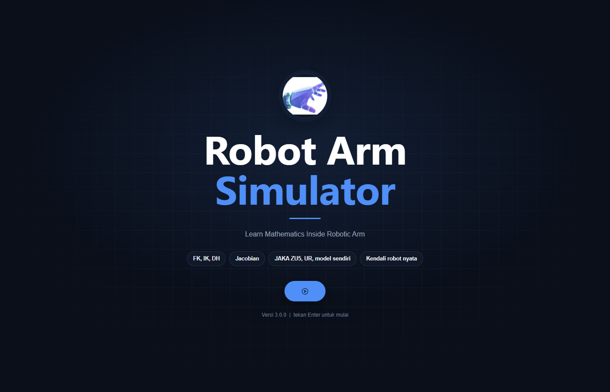
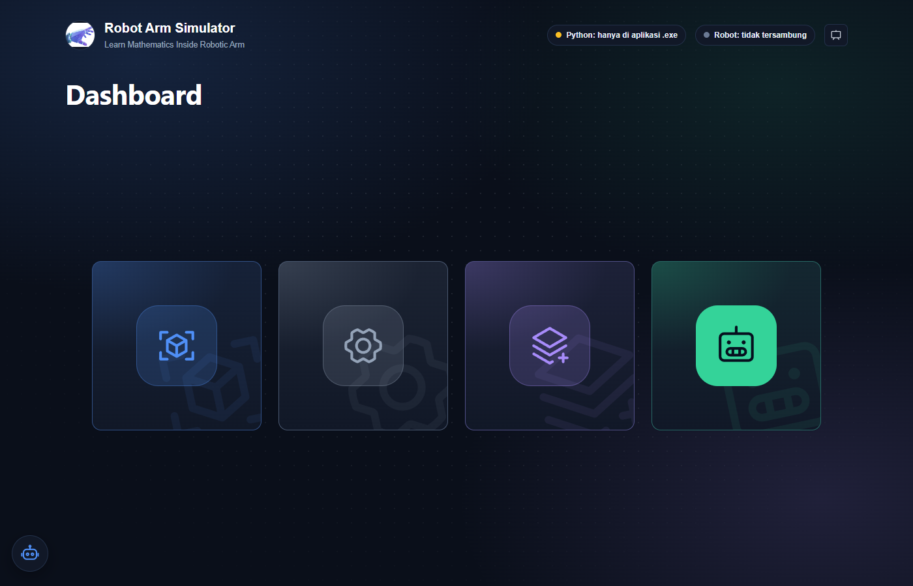
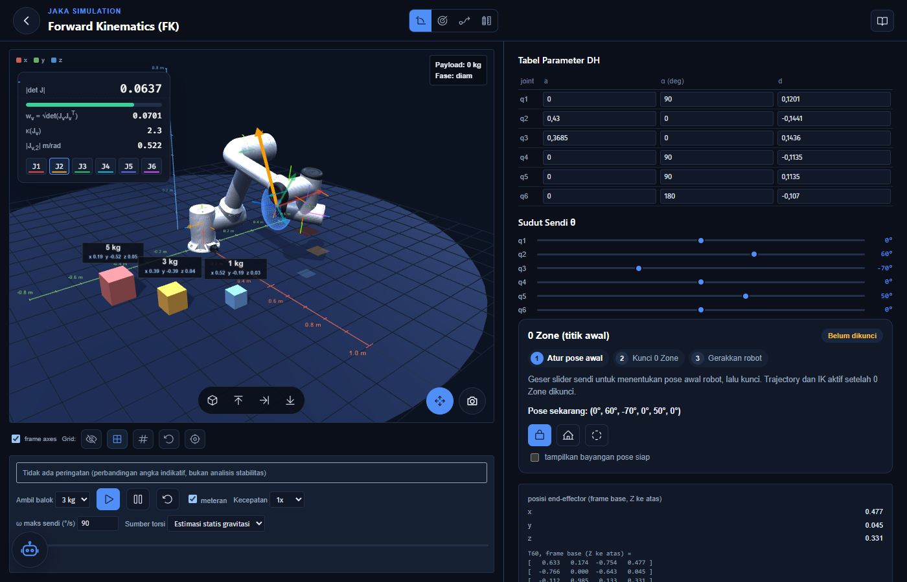
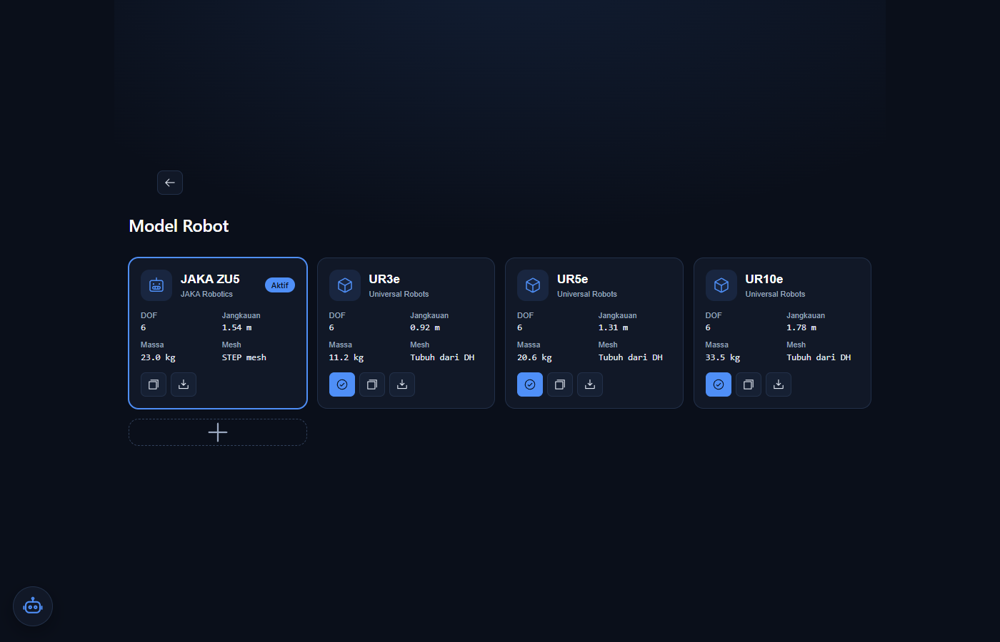
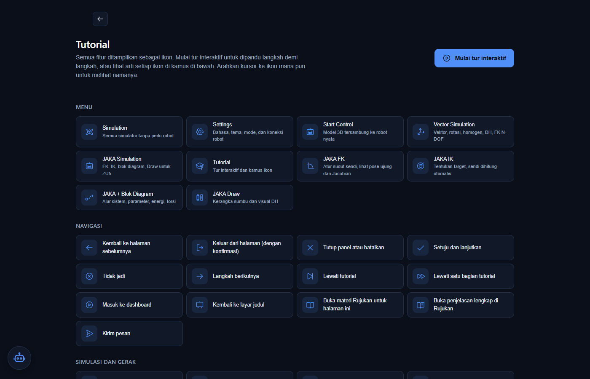

<div align="center">



# Robot Arm Simulator

**Learn Mathematics Inside Robotic Arm.**

Simple, fully visualized. Forward and inverse kinematics, DH parameters and the Jacobian, with every formula
rendered live next to a 3D robot you can move.


</div>

---

## Contents

- [What is this?](#what-is-this)
- [Features](#features)
- [Screenshots](#screenshots)
- [Supported robots](#supported-robots)
- [Installation](#installation)
- [Quick tour](#quick-tour)
- [Adding your own robot](#adding-your-own-robot)
- [Driving a real JAKA ZU5](#driving-a-real-jaka-zu5)
- [Project structure](#project-structure)
- [Development](#development)
- [Troubleshooting](#troubleshooting)
- [Credits and licenses](#credits-and-licenses)

## What is this?

Robot Arm Simulator is an offline application for understanding how a 6-DOF robot arm works mathematically. Most
simulators show a moving 3D model and hide the equations. This one shows both: when you drag a joint slider, you see
the arm move and, at the same moment, the DH matrices, the transformation chain `T06` and the Jacobian update on the
screen.

It runs in a browser with no installation, or as a Windows desktop app. It can also drive a real **JAKA ZU5** robot
through a small Python bridge, and falls back to a virtual robot when no hardware is connected, so every feature can
be tried without a robot.

The interface is icon first: feature buttons show only an icon, their name appears as a tooltip, and the **Tutorial**
page explains every icon. English is the default language and Indonesian can be selected in Settings.

## Features

| Area | What it does |
| --- | --- |
| **Robot models** | JAKA ZU5 (meshes from the official STEP file), UR3e, UR5e, UR10e, or your own model with a DH table and optional STL or OBJ meshes. Switch, duplicate, export and delete models. |
| **Vector simulation** | Five interactive lessons: vectors and dot product, rotation matrices, composite rotations, homogeneous transforms, N-DOF forward kinematics. Each has a live 3D scene and KaTeX formulas. |
| **Forward kinematics** | Joint sliders drive the active model. The DH matrices, the `T06` chain and the Jacobian are rendered live. |
| **Jacobian view** | Per-joint tool velocity arrows (columns of `Jv`), joint axes (`Jw`), the velocity manipulability ellipsoid, and a HUD with `\|det J\|`, manipulability, condition number and a singularity bar with history. |
| **Inverse kinematics** | Damped least squares IK for any model, plus closed-form geometric IK with up to 8 solutions for arms with the ZU5 structure. |
| **Block diagram** | Editable system diagram (target, IK, trajectory, rigid body, sensors) with validation and streaming data flow. |
| **Trajectory** | Quintic time scaling, pick-and-place paths, singularity warnings, energy and gravity torque estimates. |
| **Draw** | DH axis skeleton, joint frames, parameter visuals and a cinematic full-screen mode. |
| **Report and code export** | Frozen PDF or DOCX reports, and generated Python, MATLAB and Simulink code from the current page. |
| **Start Control** | Real robot monitoring, teach pendant jogging with a watchdog, FK or IK set-position, and a Python program editor with templates. |
| **Tutorial** | Guided tour, a dictionary of every icon, and the explanatory notes of each page. |

## Screenshots

| Dashboard | Jacobian view |
| --- | --- |
|  |  |

| Robot models | Tutorial |
| --- | --- |
|  |  |

## Supported robots

| Model | Source of the geometry | Body |
| --- | --- | --- |
| JAKA ZU5 | DH measured on the official STEP model, matches the official JAKA URDF | STEP meshes |
| Universal Robots UR3e, UR5e, UR10e | Official UR DH parameters | Generated from the DH table |
| Your own model | DH table you enter or import from JSON | Generated, or your STL and OBJ meshes |

## Installation

Pick the option that fits you. All of them work offline.

### Option 1: Windows installer (easiest)

1. Open the **Releases** page of this repository and download `Robot-Arm-Simulator-Setup-v3.0.0.exe`
   (or the `Portable` version, which needs no installation).
2. Run it. Windows SmartScreen may warn that the publisher is unknown because the app is not code signed. Choose
   **More info**, then **Run anyway**.
3. Start **Robot Arm Simulator** from the desktop or Start menu shortcut.

### Option 2: Web (no installation)

1. Download or clone this repository.
2. Open `app/index.html` in **Chrome or Edge**.

Everything works in the browser except Start Control, which needs the Python bridge and therefore the desktop app.

### Option 3: Run the desktop app from source

Requirements: [Node.js](https://nodejs.org) 18 or newer.

```bash
git clone https://github.com/AinurRizza67/robot-arm-simulator.git
cd robot-arm-simulator/desktop
npm install
npm start
```

To build the installer and the portable executable (output in `desktop/dist`):

```bash
npm run dist
```

## Quick tour

1. **Title screen.** Press the play button or the Enter key.
2. **Dashboard.** Choose a tile: Vector, Simulation, Robot Models or Tutorial. The two lines in the top bar show the
   Python bridge status (top) and the robot connection status (bottom). Green means connected, red means not.
3. **Vector.** Start here if forward kinematics is new to you. Lessons go from vectors to full N-DOF kinematics.
4. **Simulation.** Move the joint sliders and watch the matrices change. Turn on the Jacobian view to see velocity
   arrows and the manipulability ellipsoid. Switch to inverse kinematics to enter a target position and compare the
   solutions.
5. **Robot Models.** Change the active robot, or add your own.
6. **Tutorial.** Start the guided tour, or look up any icon in the dictionary.
7. **Settings.** Change the theme (light or dark) and the language (English or Indonesian).

## Adding your own robot

Open **Robot Models** from the dashboard and choose **Add model**.

1. Enter the **Standard DH** table, one row per joint: `a` and `d` in metres, `alpha` in degrees. Also enter the joint
   limits, a ready pose and the total mass.
2. Optionally upload **one STL or OBJ file per link** (base plus links 1 to 6). Each file must be expressed in the DH
   frame of that link, in millimetres or metres. Without meshes, the body is generated from the DH parameters.
3. Save, then choose **Use this model**. The app reloads with your robot.

Models are stored in the browser (DH data in localStorage, meshes in IndexedDB). You can export any model to JSON and
import it again, for example to share it. A minimal JSON file, here the UR5e:

```json
{
  "name": "UR5e (custom copy)",
  "maker": "Universal Robots",
  "totalMass": 20.6,
  "ready": [0, -90, 90, -90, -90, 0],
  "dh": [
    { "a": 0, "alpha": 90, "d": 0.1625, "thMin": -360, "thMax": 360 },
    { "a": -0.425, "alpha": 0, "d": 0, "thMin": -360, "thMax": 360 },
    { "a": -0.3922, "alpha": 0, "d": 0, "thMin": -360, "thMax": 360 },
    { "a": 0, "alpha": 90, "d": 0.1333, "thMin": -360, "thMax": 360 },
    { "a": 0, "alpha": -90, "d": 0.0997, "thMin": -360, "thMax": 360 },
    { "a": 0, "alpha": 0, "d": 0.0996, "thMin": -360, "thMax": 360 }
  ]
}
```

Closed-form IK is only offered for arms with the ZU5 structure. Every other model uses numerical IK.

## Driving a real JAKA ZU5

The **Start Control** page talks to the robot through `bridge/robot_bridge.py`, a Python process that exchanges JSON
lines with the app. In the desktop app the bridge is started for you.

Requirements:

- Python 3, 64-bit, available as `python` or `py -3`.
- The official JAKA SDK. It is vendor software and is **not included** in this repository. Download it from the
  [JAKA Robotics GitHub](https://github.com/JAKARobotics) or from your JAKA documentation, then copy `jkrc.pyd` and
  `jakaAPI.dll` into `bridge/sdk/`.
- The robot and the computer on the same network. Enter the robot IP address on the Start Control page.

Without the SDK, the bridge starts in **virtual robot** mode: the controller is simulated, so jogging, set-position
and the program editor can still be tried safely. Check the top bar of the dashboard: the upper line is the Python
bridge, the lower line is the robot.

> **Safety.** Moving a real robot is dangerous. Keep the emergency stop within reach, start with low speed, and make
> sure the workspace is clear. Teach pendant jogging stops automatically when the watchdog does not receive a signal.

## Project structure

```
app/                 the application: plain HTML, CSS and classic scripts, no build step
  index.html
  styles/            00_tokens.css (design tokens) to 08_redesign.css (visual layer), loaded in order
  scripts/           00_icons.js to 21_content_i18n.js, loaded in order, one shared global scope
  models/            ZU5 meshes exported from the official STEP file
  assets/            fonts (Fira Sans, Fira Code), logo, licenses
  vendor/            Three.js, KaTeX, Chart.js, jsPDF, docx, MathJax (local copies, works offline)
bridge/              Python bridge for Start Control (JSON lines over stdin and stdout)
  robot_bridge.py    process entry point, SDK wrapper, program runner
  kinematics.py      FK, IK and Jacobian, the same model as the simulator
  virtual_robot.py   simulated controller used when no robot or SDK is present
  tests/             bridge tests
desktop/             Electron shell (main.js, preload.js, prepare.js, build settings)
tools/               headless QA, screenshots and helper scripts
docs/                screenshots used in this README
```

### Conventions

- Scripts are classic (not ES modules) and share one global scope, so **file order matters**: a file may only call
  functions of earlier files at load time. The order is defined in `app/index.html`.
- Function names and file names are in English.
- Every number shown to the user uses the DH base frame (Z up). Three.js renders with Y up, so use `toUser` and
  `fromUser` (`03_robot_model.js`) to convert.
- Design tokens (fonts, radii, motion) are in `styles/00_tokens.css`. Color tokens per theme are in
  `styles/01_base.css`.
- **New icon button:** add a rule to `ICON_RULES` in `scripts/00_icons.js`, then regenerate the icon data with
  `python tools/build_icons.py <path to @phosphor-icons/core/assets/regular>`.
- **Explanatory text** belongs in the Tutorial, not under the feature. Add the selector to `NOTE_SELECTORS` in
  `scripts/19_page_notes.js`.
- **New text:** shell texts live in `I18N` (`scripts/09_app_shell.js`). Page content written in Indonesian is
  translated at runtime by `scripts/21_content_i18n.js`: add the phrase to `CONTENT_EN`.
- **New robot in the built-in list:** add an entry to `BUILTIN_MODELS` in `scripts/03a_model_library.js`.
- **Formatting:** Prettier for JS, CSS and HTML (`.prettierrc.json`), Black with line length 120 for Python.

## Development

Run the checks from the `tools` folder:

```bash
cd tools
npm install
node qa.js                 # 82 headless checks (jsdom): routing, math audit, IK, Jacobian, reports, Start Control
node screenshots.js        # real Chrome screenshots of every scenario into tools/shots
node report_export_test.js # PDF and DOCX export rendered back to images
node find_untranslated.js  # visible texts still in Indonesian while the app runs in English
python ../bridge/tests/test_bridge.py
```

`tools/paths.js` expects Chrome at the default Windows location. Set the `CHROME_PATH` environment variable if yours
is elsewhere.

The kinematic model is checked in two ways: the math audit in `qa.js` compares forward kinematics against independent
formulas, and the UR5e zero pose is verified against the published geometry.

## Troubleshooting

| Problem | Solution |
| --- | --- |
| Windows SmartScreen blocks the installer | The app is not code signed. Choose **More info**, then **Run anyway**. |
| The Python line stays red | Install 64-bit Python 3 and make sure `python` or `py -3` runs in a terminal. |
| The robot line stays red but Python is green | The SDK is missing or the robot is unreachable. Check `bridge/sdk/` and the robot IP. |
| Start Control does not work in the browser | It needs the Python bridge. Use the desktop app. |
| My uploaded mesh looks shifted or tiny | Each file must be in the DH frame of its link, and the unit (millimetres or metres) must match the unit selected in the form. |
| A model I added is gone | Models live in the browser profile. Clearing site data removes them. Export to JSON for a backup. |
| `npm start` cannot find Electron | Run `npm install` inside the `desktop` folder first. |

## Credits and licenses

- Three.js, KaTeX, Chart.js, jsPDF, docx (MIT) and MathJax (Apache 2.0). See `app/vendor/LICENSES.md`.
- Fira Sans and Fira Code (SIL Open Font License 1.1), Phosphor Icons (MIT). See `app/assets`.
- The JAKA ZU5 geometry is derived from the robot model published by JAKA Robotics. Joint limits and the 180 deg/s
  joint speed limit come from the JAKA Zu Hardware User Manual V12, Table 5-1.
- UR3e, UR5e and UR10e use the official Universal Robots DH parameters.
- JAKA and Universal Robots are trademarks of their owners. This project is independent and not affiliated with them.

This is a kinematic simulator. It has no dynamic model (mass matrix, Coriolis, friction), and torque values are static
gravity estimates.
